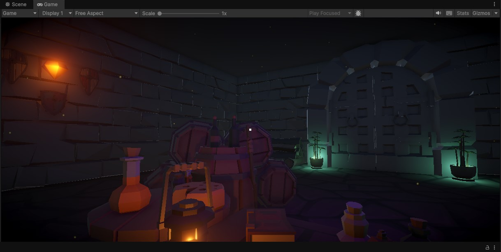
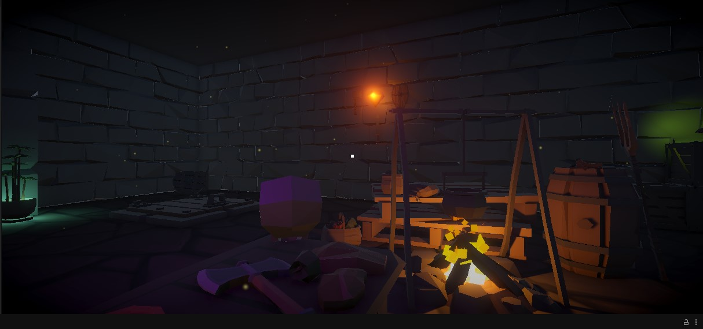
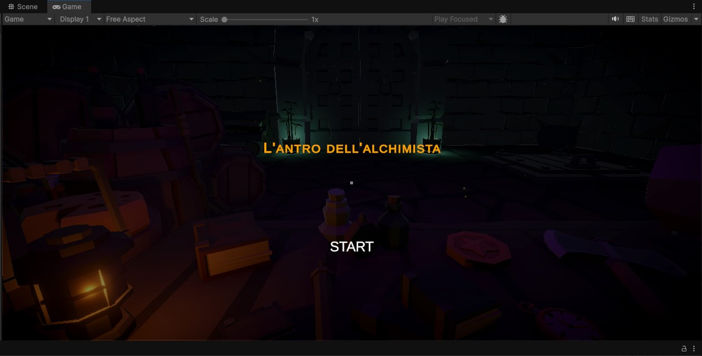
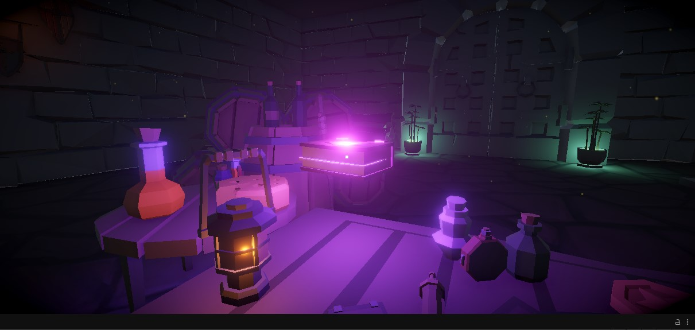
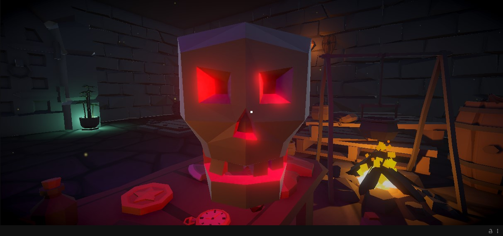

# The Alchemist's Lair — Gaze Interaction in Unity

**Unity 6.5 · C# · URP · Raycasting · Interactive 3D Environment**

An academic immersive-experience prototype developed for the Virtual Reality course in the MSc in Digital Humanities. Set in a low-poly alchemist's chamber, the experience invites users to explore a fixed viewpoint with the mouse and reveal magical effects by looking at objects. It is an exploratory experience rather than a score-based game.

## Gameplay Demo

Watch the demonstration of the gaze-based interactions,
dynamic lighting and visual effects.

🎬 [Watch the Unity gameplay demo on YouTube](https://youtu.be/ecH1rXpAl-c)

🎮 [View the project on itch.io](https://davide-deathgun.itch.io/lantro-dellalchimista)

- This repository contains **original C# scripts and documentation only**, not a complete Unity project or executable build.

## Interaction design

Five objects (book, potion, coin, skull and cauldron) respond to camera-centered raycasts. A **short gaze (1 second)** triggers a light reaction; a **long gaze (2.5 seconds)** can trigger movement, rotation, particles and audio. Looking away resets the effects. The skull has a special surprise interaction.

## Code

| File | Responsibility |
|---|---|
| [`GazeDetector.cs`](Assets/Scripts/GazeDetector.cs) | Casts a ray from the camera and tracks the object currently observed |
| [`AlchemistItem.cs`](Assets/Scripts/AlchemistItem.cs) | Applies timed gaze thresholds and object-specific effects |
| [`MouseLook.cs`](Assets/Scripts/MouseLook.cs) | Mouse-controlled camera rotation with vertical limits |
| [`LuceTremolante.cs`](Assets/Scripts/LuceTremolante.cs) | Fire/lantern light fluctuation using Perlin noise |

## Visual highlights

| Environment | Menu |
|---|---|
|  |  |

| Floating book | Skull effect |
|---|---|
|  |  |

## Implementation notes

- Designed as a single room with an exploration-focused, fixed-position camera.
- Includes dynamic lights, particles, audio and URP post-processing.
- The original project was built for Windows 64-bit; **no WebGL build is supplied here**.
- Original 3D environment assets are from **Synty Studios POLYGON Adventure**, licensed through Unity's student offering; source assets are **intentionally excluded** from this public repository. Some audio originates from Pixabay.
- This is an academic prototype, not a production-ready game.

## Limitations and potential improvements

The viewpoint remains fixed and only five objects have gaze-based interactions. Future improvements could include free movement, an on-screen gaze timer, and additional interactive props.

## Credits

Unity project and C# implementation: **Davide Passariello**. Third-party models and audio remain the property of their respective creators. This repository does not grant a licence to redistribute the excluded third-party Unity assets.
